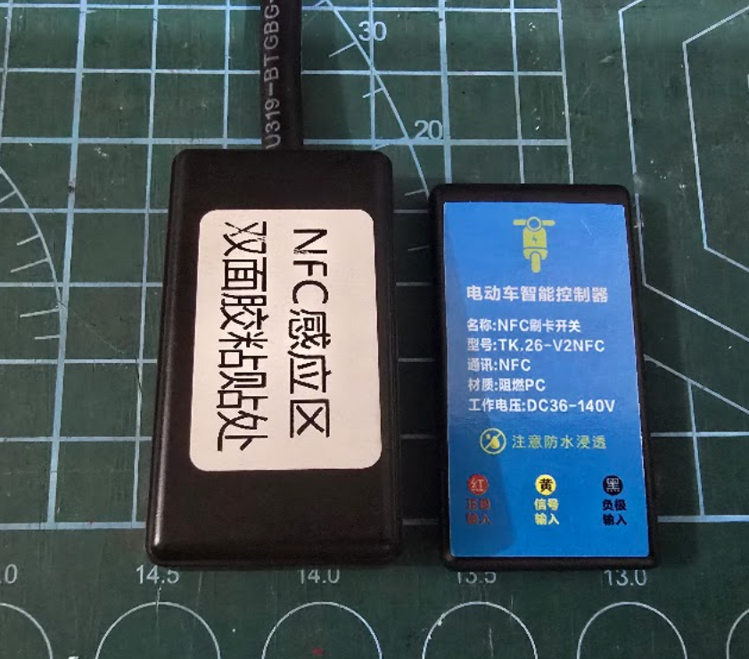
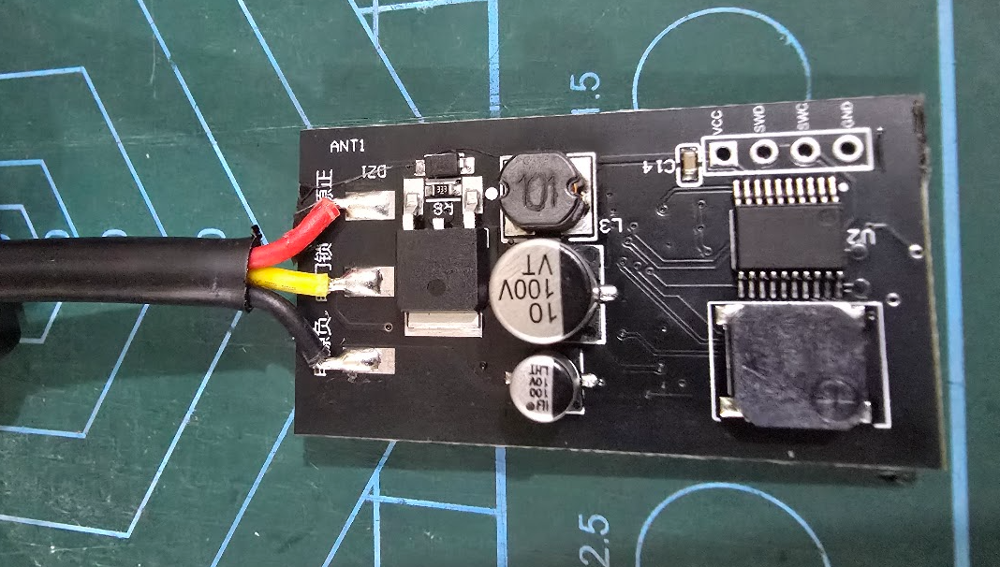
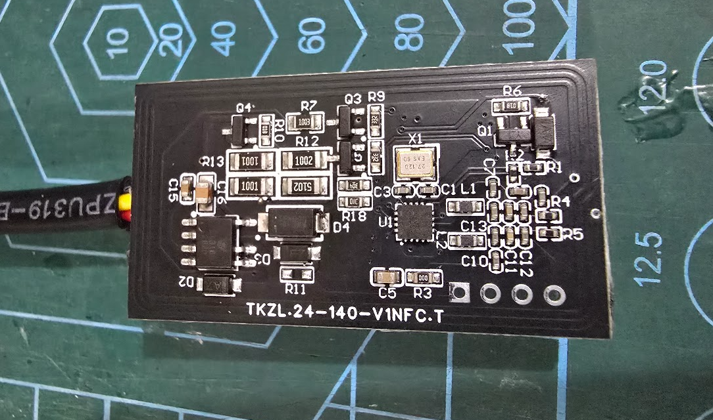
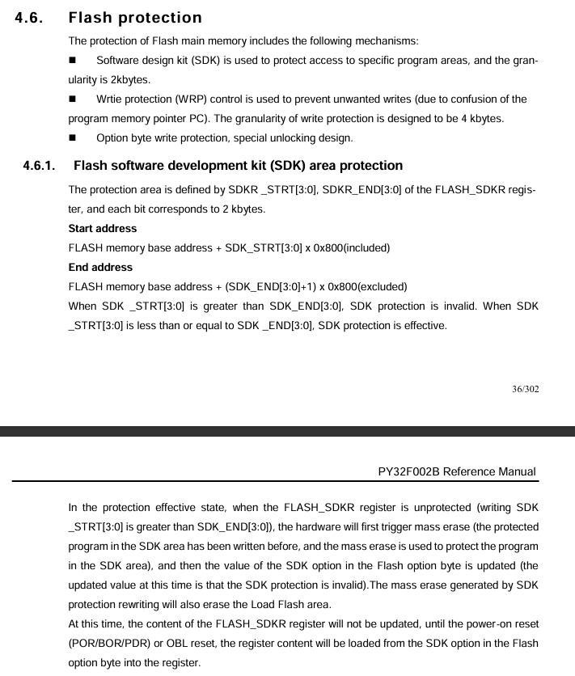

# Rebuilding the firmware of a cheap NFC bike switch

This is a small NFC card switch sold for electric bikes and scooters. You wire it between the
bike's supply and its controller, tap an enrolled card on it, and it switches the bike on or
off. I wanted to know how it works and whether its firmware could be extracted and turned back
into source code.

I did this with the help of Claude. I handled the hardware and steered the work.
Claude did most of the hands-on work: it read the firmware out of the locked
chip, worked through it in IDA, and rewrote it in C.



The label calls it an "NFC刷卡开关" (NFC card switch), model TK.26-V2NFC, rated for DC 36-140 V.
It has three wires: red for the supply, yellow for the signal output, black for ground.

I purchased mine from [here](https://item.taobao.com/item.htm?id=1055220008984)

## What's inside



The front of the board holds the power side:

- a buck regulator (the inductor and the 100 V capacitors) that brings the bike's supply down
  to a voltage the logic can use
- a MOSFET that switches the yellow output wire
- a buzzer
- **U2**, the microcontroller: a **Puya PY32F002B**, a cheap Cortex-M0+ with 24 KB of flash
  and 3 KB of RAM
- a 4-pin header marked VCC / SWD / SWC / GND, which is the debug port



The back holds the NFC side:

- **U1**, a **Wisesun WS1820T** NFC reader chip. It behaves like the well-known NXP MFRC522,
  so most of its registers have the same names and meanings.
- **X1**, a 27.12 MHz crystal for the NFC chip
- the antenna, which is the copper trace that runs around the edge of the board

The microcontroller talks to the NFC chip over SPI, but it doesn't use the hardware SPI
peripheral. It toggles the pins in software (bit-banged SPI).

We first took the MCU for a PY32F002A. It's actually a PY32F002B. The two look almost the
same over the debug port, we discovered it was PY32F002B when decompiling the firmware.

## Step 1: Getting the firmware out

I connected a J-Link to the SWD header, and Claude drove it from there. The debugger could see
the chip, but flash reads failed after the first few words:

```
mem32 0x08000000  -> 200007F8      (ok)
mem32 0x08000100  -> Could not read memory.
```

The flash wasn't locked with the usual read protection (RDP). The option bytes showed RDP at
level 0. What blocked the reads was Puya's "SDK area" protection, set over all 24 KB.

SDK protection blocks reads from the debugger, but it still lets code running from flash read
flash. 



To use this, Claude first needed to know where the real instructions were, without being able
to read any of them. It started by tracing the firmware as it ran normally: halting the CPU
again and again and noting the program counter each time. That gave a list of addresses that
were definitely the start of an instruction. Claude then tried each address as a possible
load. It pointed the CPU's registers at memory it could already read, ran that one
instruction, and checked whether the known value showed up in a register. Most addresses did
nothing useful, but a few turned out to be real `LDR` instructions. Once those returned the
first correct bytes of flash, Claude could disassemble them and pick better instructions by
reading the code instead of guessing.

The firmware needs that to load its own constants. So instead of asking the debugger
for the bytes, Claude made the CPU read them:

1. Find an `LDR` instruction already in the firmware. Claude used `ldr r0, [r0]` at
   `0x08000526`.
2. Put the wanted address in `r0`.
3. Point the PC at that instruction and run exactly one instruction.
4. Read `r0` over SWD. The debugger can always read core registers.

J-Link's normal single-step doesn't work here, because it tries to read the instruction first,
and that read is blocked. Claude set a hardware breakpoint (FPB) on the next instruction
instead, and masked interrupts with `PRIMASK` so nothing else ran in between. Repeat that for
every word and you have the whole image: 6,144 reads for 24 KB.

The first dump used a different `LDR`, and it looked fine. The vector table was right and the
strings made sense. About two thirds of it was wrong. That instruction had a branch in front
of it that skipped the load most of the time, so the register kept an old value. Because the
wrong value was the same every time, reading three times and voting didn't catch it.

How it was fixed:

- dump again with a different instruction
- compare the result against the words the debugger *can* read
- read the whole flash twice and re-read every word where the two passes disagree

Every word of the final image was read at least twice. Nothing on the chip was erased or
written. The dump script is in [`firmware/dump_flash_gadget.py`](firmware/dump_flash_gadget.py)
and the image is [`firmware/firmware_PY32F002B_full_24KB.bin`](firmware/firmware_PY32F002B_full_24KB.bin).

## Step 2: Understanding it in IDA

Claude loaded the image into IDA and worked through it before writing any C. I set one simple
rule: name and type everything first (functions, parameters, locals, globals and the structs
they use), then port.

Some things that helped:

- **Find the vendor's SDK.** The firmware uses Puya's HAL. By checking a few constants and
  struct sizes against each release, Claude pinned it to the **PY32F002B Firmware package
  1.2.1**. That turned 58 functions from unknown code into known library code.
- **Trust the assembly, not the decompiler.** Hex-Rays hides some details. For example, it
  shows two back-to-back writes to the flash unlock register as a single write. Claude checked
  every line of the port against the disassembly.
- **Keep the database in scripts.** Every name and type lives in a Python script that IDA
  runs, so the database can be rebuilt from the raw dump at any time.

In the end the firmware has 168 functions: 84 application, 58 HAL and 26 from the compiler's
runtime library.

## What the firmware does

Once everything had a name, the behavior was easy to follow.

**Reading cards.** Every 50 ms the reader looks for a card. It tries an ISO14443-A card first
(most NFC tags and MIFARE cards), then an ISO14443-B card. For Type B it sends the command that
returns the UID of a Chinese resident ID card. Between polls it holds the NFC chip in reset to
save power.

**Access control is by UID only.** The firmware never authenticates the card or reads any
data from it. A MIFARE default key sits in RAM, but no code uses it. This means any card, or
any phone or tool that can pretend to be a card with the same UID, will switch the bike on.

**The card list.** The reader keeps up to 20 cards in the last flash sector. The rules are:

- With no cards stored, the first card you tap gets enrolled.
- An enrolled card toggles the output.
- An unknown card gets three beeps.
- With the output off, hold an enrolled card for 6 seconds to clear the list and enter learn
  mode. Learn mode adds every card you tap for 15 seconds.

**Commands over the power wire.** The reader watches its own supply voltage. If you switch
the power on and off quickly, it counts the pulses. 4 pulses does a factory reset, and 8
pulses turns a protection feature on or off.

**Protection.** With protection on, the reader switches the output off and beeps if the supply
voltage drops while the output is on.

**Debug output.** The board prints a log on a UART at 115200 baud, with messages like
`UART_OK_V2.0` and `卡号不在系统` ("card not in the system").

**Option bytes.** On first boot the firmware rewrites the chip's option bytes and turns the
reset pin into a normal GPIO. It doesn't set the SDK protection; whoever programmed the board
did that separately.

## Step 3: Rewriting it in C

With the database done, Claude ported the firmware in stages:

1. boot, clocks and GPIO
2. debug UART, buzzer, supply measurement and the 1 ms tick
3. the NFC chip and ISO14443-A
4. ISO14443-B and the ID card UID
5. the card list, the settings in flash and the main loop

The source is in [`src/`](src/). It builds with GCC 14.2 and the unmodified Puya HAL 1.2.1.
Each function has a comment that points at the address it came from in the original
firmware.

The goal was the same behavior, not the same bytes. The vendor built with Keil and this port
builds with GCC, so the machine code differs. A few places needed care:

- **printf.** The vendor used Keil's small C library. GCC's newlib-nano printf added about
  3 KB, which didn't fit, so Claude wrote a small printf that handles only the formats the
  firmware uses, and tested it on the PC against the standard `snprintf`.
- **Flash layout.** Saving settings erases the whole last 4 KB sector, so the code has to fit
  in the first 20 KB. The GCC build is about 18 KB.
- **Option bytes.** The code that rewrites the option bytes is off by default. Turning the
  reset pin into a GPIO makes a test board harder to recover.
- **Constants.** A file of compile-time checks (`vendor_constants_check.c`) pins each HAL
  value the port uses to the value seen in the original firmware.

When the port was done, Claude compared every application function with the disassembly, line
by line, and every HAL function with the 1.2.1 source. That check found one real difference: a
lock flag in the UART receive code that the port had missed.


## Files

| Folder | What's in it |
|---|---|
| [`datasheet/`](datasheet/) | PY32F002B datasheet and reference manual, WS1820T datasheet |
| [`firmware/`](firmware/) | the dumped 24 KB image and the dump script |
| [`src/`](src/) | the C rewrite |
| [`images/`](images/) | photos of the reader |
